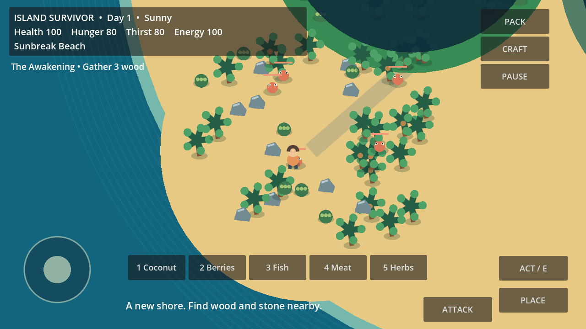

# Island Survivor: Lost World

An offline top-down survival adventure for Godot 4.7.2, targeting Android landscape. **Development build, not release ready.**

Source is on `development/first-playable`; draft review: https://github.com/acrooxy/Island-Survivor-Lost-World/pull/1 . The current automated logic suites have 41 passing checks. Android APK export succeeds, but installation/play could not be verified because the available emulator requires unavailable hardware acceleration. AdMob/UMP and a production AAB are not implemented.

Open `project.godot` in Godot 4.7.2 and press F6/F5 to play. Desktop: WASD/arrows, E interact, Space attack, C craft, I backpack, 1–5 consume food/herbs. Android: left thumb joystick and right action buttons. Craft a structure to select its preview, then PLACE on clear land. Pack, crafting and pause screens stop survival time.

Follow the upper-left quest text. Nearby coconuts restore food and water. Collect wood, stone and leaves, make an axe and a shelter, then explore. Campfires cook fish/meat immediately; water collectors provide safe water every 30 seconds. Fishing requires a crafted rod at the island coast. Shelters restore 70 energy once per minute. Death returns you to a shelter with restored needs and temporary protection, losing 20% basic materials. Crabs are peaceful until injured. Other wildlife is dangerous.

## Project layout
- `scripts/survival.gd`: balance loading, transactional inventory and recipes, survival timing and versioned saves.
- `scripts/game.gd`: current world, player, UI, animals, interactions and quest orchestration. This remains too large for final production and needs further separation.
- `data/balance.json`: survival timings, movement, stack/slot capacities and recipes.
- `tests/`: executable Godot headless tests. Story tests use supplied materials to test progression, not an honest full-length player playthrough.
- `docs/PROGRESS.md`: persistent milestone status and next actions.
- `docs/TESTING.md`: commands, evidence and outstanding device checks.

No advertising SDK is currently shipped; offline mode requests no network permission. No production ad IDs, credentials or release signing keys are included.

See design, known issues, asset provenance and release preparation in `docs/`. The supplied code is not evidence of release readiness; use the recorded test scope.
